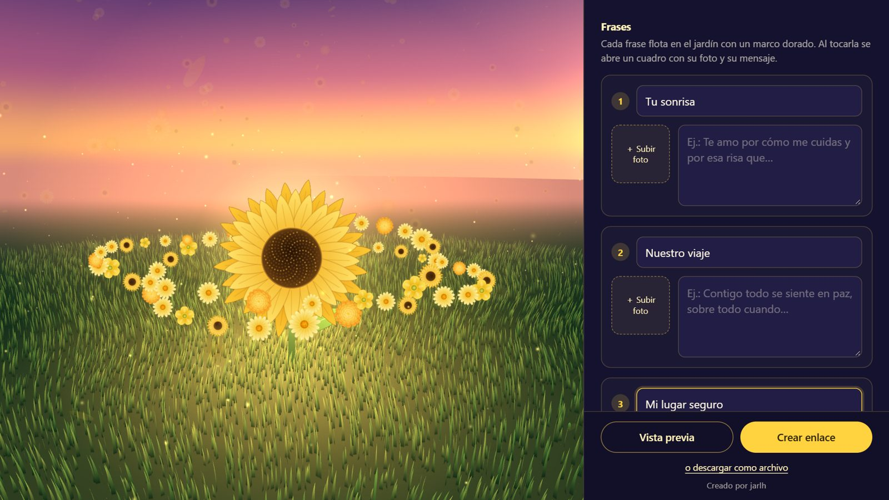
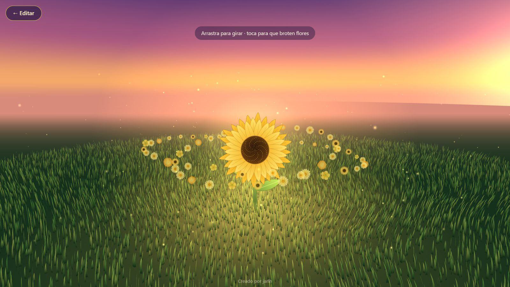

# Flores Amarillas

[English](README.md) · **Español**

Una web para armar un jardín de girasoles en 3D como regalo: pones de quién es
y para quién, agregas hasta seis mensajes con fotos, eliges una canción y lo
compartes como enlace o como un archivo HTML.

**En vivo:** [regala-flores-amarillas.pages.dev](https://regala-flores-amarillas.pages.dev)

<p align="center">
  
  
</p>

<p align="center"><sub>Editor con vista previa 3D en vivo · el jardín terminado</sub></p>

`JavaScript` `three.js` `Cloudflare Pages` `Pages Functions` `D1 (SQLite)`

## Qué hace

- **Editor con vista previa en vivo.** De/Para, hasta seis mensajes, una foto
  para la flor central y una por mensaje; el jardín se actualiza mientras
  escribes y el borrador se guarda en el navegador.
- **Dos formas de entregar el regalo.** *Crear enlace* lo guarda y devuelve un
  enlace corto (`/r/<id>`); *Descargar regalo* genera un solo archivo HTML con
  las fotos adentro, que no depende del servidor.
- **Música sin alojar audio.** En los enlaces la canción es un video de YouTube
  que suena con la IFrame API, con minuto de inicio opcional. El archivo
  descargado puede llevar un audio propio.
- **Quien lo crea lo puede borrar.** Al crear el regalo se devuelve una clave
  secreta que queda en su navegador; *Borrar este jardín* la envía para borrar
  el regalo y sus fotos.
- Respeta `prefers-reduced-motion`.

## Cómo está hecho

```
public/index.html              editor + jardín 3D (three.js), una sola página
public/_redirects              /r/* sirve la misma página, que carga el regalo
functions/api/regalos/index.js POST   crea un regalo
functions/api/regalos/[id].js  GET    lee un regalo con sus fotos
                               DELETE lo borra (cabecera X-Clave)
lib/util.js                    respuestas JSON, SHA-256, ids aleatorios
schema.sql                     tablas de D1
```

Decisiones que vale la pena mencionar:

- **Las fotos se reducen en el navegador** y viajan como data URL JPEG, así el
  servidor nunca procesa imágenes. La API rechaza lo que no sea un data URL
  JPEG/PNG/WebP o pase de ~330 KB.
- **Una fila por foto.** D1 limita cada fila a 2 MB, así que las fotos van en
  su propia tabla (`fotos`) y no dentro del JSON del regalo. Regalo y fotos se
  escriben en un solo `batch`: nunca queda un regalo a medias.
- **Límite por IP con hash.** Cada regalo guarda el SHA-256 de la IP (nunca la
  IP) y se permiten 60 por hora por IP. Es alto a propósito: en datos móviles
  mucha gente comparte IP.
- **La clave de borrado se guarda con hash.** El servidor solo tiene su
  SHA-256; la clave en claro existe únicamente en el navegador de quien lo creó.
- **Toda entrada se recorta y se limita** en el servidor (nombres 40
  caracteres, títulos 30, mensajes 500, máximo seis mensajes, id de YouTube
  validado por patrón).
- **Ids cortos y legibles.** Usan un alfabeto sin caracteres que se confunden
  (sin `l`, `I`, `O`, `0`, `1`), así un enlace dictado en voz alta igual
  funciona.

## Correrlo en local

```bash
npm install
npm run db:local
npm run dev
```

Abre en `http://localhost:5189`. `db:local` crea las tablas de D1 en el SQLite
local de Wrangler.

## Publicar

```bash
npx wrangler d1 create regala-flores-amarillas   # una vez; el id va en wrangler.toml
npm run db:remoto
npm run deploy
```
