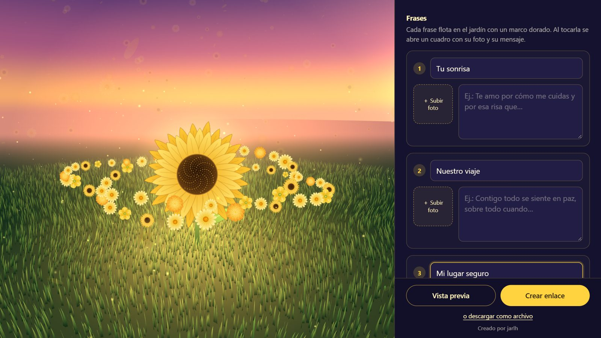
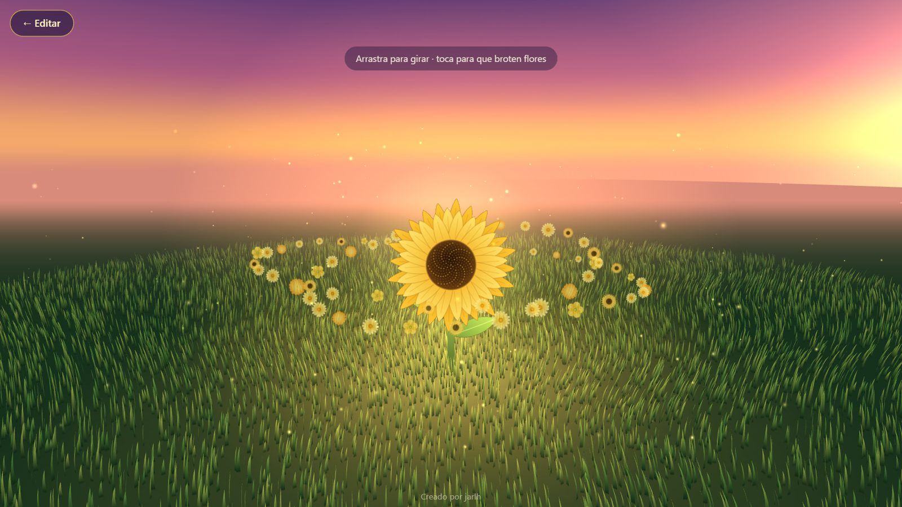

# Flores Amarillas

**English** · [Español](README.es.md)

A web app to build a 3D sunflower garden as a gift: you write who it is from
and who it is for, add up to six messages with photos, pick a song, and share
it as a link or as a standalone HTML file.

**Live:** [regala-flores-amarillas.pages.dev](https://regala-flores-amarillas.pages.dev)

<p align="center">
  
  
</p>

<p align="center"><sub>Editor with live 3D preview · the finished garden</sub></p>

`JavaScript` `three.js` `Cloudflare Pages` `Pages Functions` `D1 (SQLite)`

## What it does

- **Editor with live preview.** From/To, up to six messages, a photo for the
  center flower and one per message; the garden updates as you type and the
  draft is saved in the browser.
- **Two ways to deliver the gift.** *Crear enlace* stores it and returns a
  short link (`/r/<id>`); *Descargar regalo* produces a single HTML file with
  the photos embedded, so the gift does not depend on the server.
- **Music without hosting audio.** In shared links the song is a YouTube
  video played through the IFrame API, with an optional start time. The
  downloaded file can embed an audio file instead.
- **The creator can delete it.** Creating a gift returns a secret key that
  stays in the creator's browser; *Borrar este jardín* sends it to delete the
  gift and its photos.
- Respects `prefers-reduced-motion`.

## How it is built

```
public/index.html              editor + 3D garden (three.js), single page
public/_redirects              /r/* serves the same page, which loads the gift
functions/api/regalos/index.js POST   create a gift
functions/api/regalos/[id].js  GET    read a gift with its photos
                               DELETE delete it (X-Clave header)
lib/util.js                    JSON responses, SHA-256, random ids
schema.sql                     D1 tables
```

Decisions worth noting:

- **Photos are resized in the browser** and sent as JPEG data URLs, so the
  server never processes images. The API rejects anything that is not a
  JPEG/PNG/WebP data URL or is over ~330 KB.
- **One row per photo.** D1 caps a row at 2 MB, so photos live in their own
  table (`fotos`) instead of inside the gift's JSON. Gift and photos are
  written in a single `batch`, so a gift is never saved half-way.
- **Rate limit per IP, kept for one hour.** Each gift stores an HMAC of the
  client IP with a server secret (`IP_SECRETO`), never the IP itself, and
  creation is capped at 60 per hour per IP. A plain SHA-256 of an IPv4 can be
  reversed by trying them all; without the secret this cannot. The value is
  cleared once the hour is over, since it is only needed for the limit. The
  limit is high on purpose: on mobile networks many people share an IP.
- **The delete key is stored hashed.** The server keeps only its SHA-256; the
  plain key exists only in the creator's browser.
- **All input is trimmed and capped** server-side (names 40 chars, message
  titles 30, messages 500, max six messages, YouTube id validated by pattern).
- **Short, readable ids.** Gift ids use an alphabet without look-alike
  characters (no `l`, `I`, `O`, `0`, `1`), so a link read aloud still works.

## Running locally

```bash
npm install
npm run db:local
echo "IP_SECRETO=$(openssl rand -hex 32)" > .dev.vars   # once
npm run dev
npm test
```

Opens at `http://localhost:5189`. `db:local` creates the D1 tables in
Wrangler's local SQLite.

## Deploy

```bash
npx wrangler d1 create regala-flores-amarillas   # once; put the id in wrangler.toml
npm run db:remoto
npx wrangler pages secret put IP_SECRETO   # once, before the first deploy; a long random value
npm run deploy
```
